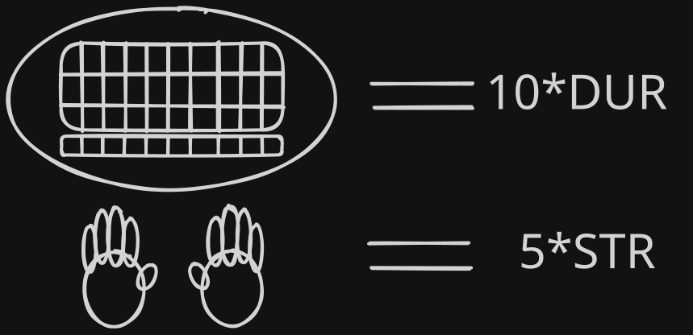

Inventory is a slot system with coldbar and hotbar. Coldbar is their main, big space like backpack or them having something on their back directly. Coldbar is not accessible easily, entity cannot access it in fight without using a whole turn for this. Hotbar on the other hand is entity's easily accessible inventory, like their pockets or their holster, sheath, etc.

Both coldbar and hotbar spaces arent calculated by any formula but obtained by equipping items that give such inventory slots. BUT the maximum amount of slots that they can get can be calculated by formula `10*DUR` (10-60 without any additional buffs).

Its worth mentioning that player's hands are two separate item-holders that can hold items with limit of `5*STR` slots (5-30 without any additional buffs) each.

